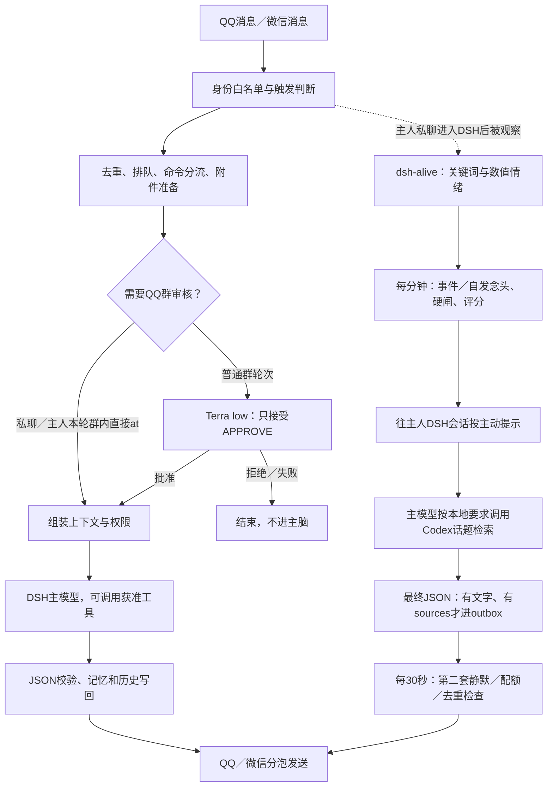

# Bot 说话流程与控制规则

> 本文是2026-11-06调整前的取证快照。用户审阅后已要求并实施：开放主人QQ戳一戳、只读空间及分享卡片；主动提示保留情绪数值，并经再次审阅允许上游情绪方向预设和亲密欲望补充描述，以PERSONA.md和当前语境为准，仍不注入40字／一两句等硬性要求或动作菜单；取消每轮强制检索，允许无来源关怀和单独表情；移除桥接的第二套配额／冷却／静默。状态语义关口的AI改造尚未实施，建议见 [dsh-alive状态关口智能化审阅.md](dsh-alive状态关口智能化审阅.md)。下文用于理解改前问题，不应当成调整后的完整现状。

核对日期：2026-11-06。范围：当前生效的 QQ／微信桥接、Harmonia 专属 DSH 预设、dsh-alive 1.1.1 本地源码及运行配置。按实际调用整理，包含此前文档未充分说明的策略。本文是现状报告，不新增或调整运行行为。

## 1. 谁决定 bot 会不会说话

最终结果由多层共同决定：接入和白名单、本地触发规则、排队和去重、群审核模型、提示词与主模型、输出格式校验、发送器，以及平台接口。主动开口还多一套 dsh-alive 的关键词控制、数值情绪、开口评分和第二阶段投递限制。

上图的命令和系统通知存在旁路，详见第 3 节。只有通过相应入口的消息才进入后续步骤；群聊未抽中、被审核拒绝、附件准备失败等都可能让主模型完全看不到这条消息。

## 2. 正常收到一条消息的完整顺序

| 顺序 | 当前处理 | 谁决定／什么情况会停 |
|---|---|---|
| 1 | QQ 由 SnowLuma 提供 OneBot 事件；微信由 iLink 持续轮询 | 连接、登录、接入认证失败时收不到。QQ 排除机器人自己发送的事件；微信仅处理有效私聊消息 |
| 2 | 将文本、真实 at 段、图片、引用、转发、戳一戳等归一化 | 当前正文先限 12,000 个 JS 字符。戳一戳变成一段固定文字，不获得主人群权限 |
| 3 | 检查联系人／群白名单与主人身份 | 群只接受白名单群；私聊主人及额外允许联系人可进。额外联系人没有主人权限 |
| 4 | QQ 群判断是否接话 | 真实 at 直接进入；文字叫名、引用最近由本桥接发出的消息、短时补图、戳一戳走直接互动冷却；其他群消息走概率和群冷却。微信私聊和获准 QQ 私聊不抽概率 |
| 5 | 主人有操作权限的消息更新“最近活动时间”和最近使用渠道 | 包括主人私聊及群内本轮直接 at。该活动后来也影响主动消息静默与渠道选择 |
| 6 | 检查入站时效、运行中去重和持久收据；进入全局串行投递队列 | 过期消息不处理；收据已经存在不重做；普通任务队列上限 50。先写 processing，再做后续副作用 |
| 7 | `/reset` 硬命令分流；否则准备附件 | reset 绕过普通附件／群审／主模型；正常轮次展开合并转发、引用并下载转换本条附件 |
| 8 | 普通 QQ 群取最近 7 条审核语境并调用独立审核模型 | 私聊、主人本轮群内直接 at 跳过。审核未批准或读取语境失败则停止，通常无群内提示 |
| 9 | 标出本条哪些图片是表情；进入统一主脑路由 | 再核对白名单、时效；指定跨群转告和 `/完成` 可在此旁路执行 |
| 10 | 读取动态 PERSONA、统一长期记忆、该范围近期历史和表情候选 | 主人 QQ／微信私聊共用近期窗口；各群独立。所有范围共用同一长期记忆 |
| 11 | 确定 DSH 会话、专属预设及工具权限，跟随全局默认模型 | 主人群内直接 at 使用独立主人权限会话，但仍只注入当前群历史。普通群消息回公共会话 |
| 12 | DSH 处理本轮，模型可先调用工具，再给最终 JSON | 普通回复经桥接等待事件：无进展 3 分钟或整轮 15 分钟停止；只选最后无工具调用的 assistant 文本作为最终答复 |
| 13 | JSON 解析、结构与附件权限校验 | 解析／字段／数量／URL／文件校验不通过，整轮失败；模型也可 reply=false 主动选择不回复 |
| 14 | 更新表情索引、长期记忆和该范围近期窗口 | 发生在实际发送前。故历史可能已经含模型答复，但之后平台发送失败；这两步不是事务 |
| 15 | 按 bubbles 数组逐泡发送，然后表情、图片、文件 | QQ 先将 Markdown 转纯文本；微信普通回复直接发文本。每泡等待配置的分泡间隔，QQ 要等接口回执 |
| 16 | 保存 completed 或 failed-or-uncertain，清理临时附件 | 部分成功、超时、断电遗留 processing 等不自动重发。私聊主脑失败可发一次固定失败通知 |

关键入口：[QQ](E:/QQbot/Harmonia/adapters/qq.mjs:68)、[微信](E:/QQbot/Harmonia/adapters/wechat.mjs:33)、[投递与排队](E:/QQbot/Harmonia/lib/delivery.mjs:15)、[路由](E:/QQbot/Harmonia/brain/unified-router.mjs:69)。

**群接话的细节：**普通成员 5%、主人 20%；非直接消息还受群冷却影响。本轮真实 at 不抽概率、不受这层冷却。文字叫名等 direct 标记不等于 mentioned，不提升权限。冷却时间在入队前预占，后面审核拒绝、模型沉默或推理失败也已经消耗了这次群接话间隔。补图判定为同群同一用户、此前直接互动后 60 秒内带图；引用机器人判定依赖本进程保存的最近 500 条发送 ID。

桥接和主脑路由各有一层串行队列，主人私聊和群消息可能互相排队；主动轮次直接进入 DSH，不经过普通桥接投递队列。

## 3. 不经过主模型的发言／操作

| 触发 | 本地实际行为 |
|---|---|
| 主人私聊 `/reset`；主人群内真实 at 后 `/reset` | 取消该范围旧轮次及 DSH inbox，清空近期窗口，发送固定成功回执。保留会话 ID、长期记忆、人设、原始日志、去重、主动配额。普通用户收到固定拒绝文本 |
| 主人私聊精确命令 `去 QQ 群 群号 里 发送 原文` 等同格式 | 正则解析后核对群白名单，原样转发并给固定回执，不由主模型决定收件人或改写内容。引用、转写、附件不提供该授权 |
| 有主人操作权限的消息匹配 `/完成 待办ID` | 本地将该待办标为完成并回复固定文本 |
| 主脑未配置 | 固定配置提示 |
| 私聊主脑失败、reset 失败 | 本地固定失败提示；有持久去重，不会因重连反复通知 |

代码：[reset](E:/QQbot/Harmonia/lib/reset.mjs:5)、[转告正则](E:/QQbot/Harmonia/brain/unified-router.mjs:13)、[失败通知](E:/QQbot/Harmonia/lib/delivery.mjs:8)。未实现 `/new`。

## 4. 群审核究竟做了什么

只有普通 QQ 群轮次调用 `gpt-6.1-terra`、low。使用当前默认提供商，独立一次性请求，无角色卡、长期记忆、通用工具或持久会话历史。资料为本条文字／已准备图片，以及此前最近最多 7 条同群记录；这些记录包含未触发接话的群消息和机器人消息。

历史排除跨群、过期、缺时间、重复、当前消息和本群 reset 前内容；历史附件只给类型／说明，不下载。该 7 条只用于审核，不写进主脑窗口或长期记忆。

审核提示要求拒绝：性别政治，性别／民族／种族／宗教歧视，色情露骨，威胁骚扰，血腥虐待，诈骗垃圾广告，违法伤害指导，诱导绕权限／泄露隐私，直接提及毛泽东／习近平，以及审核模型认为应拒绝的其他内容。正常游戏、新闻、学术、无害玩笑可通过。

只有去除首尾空白后恰为 `APPROVE` 才放行。REJECT、多余解释、输出过长、请求失败、超时、取历史失败都不放行。调用端 45 秒，服务端 40 秒上限。审核是在附件准备之后、主脑和表情收藏之前。

没有在主模型回复后再运行同一套内容审核；私聊也没有这一层群审。来源：[审核规则](E:/QQbot/Harmonia/brain/moderation.mjs:4)、[一次性调用](E:/QQbot/Harmonia/plugins/dsh-agent/moderation.mjs:9)。

## 5. 主模型实际收到哪些东西

PERSONA 是唯一角色卡，但请求还会拼接多处代码中的运行规则，其中也有话术、工具和主动行为要求。

| 来源 | 内容及作用 |
|---|---|
| `config/PERSONA.md` | 每轮读取的身份、关系、语气、聊天方式和 `_` 工作模式等 |
| `plugins/dsh-agent/index.mjs` | 追加身份信任、工具使用、Codex 派活、记忆、表情、附件权限、JSON 格式等系统要求 |
| `brain/unified-router.mjs::buildPrompt` | 本轮可信路由说明、权限、记忆资料、历史、当前消息、候选表情与附件状态 |
| `plugins/dsh-agent/history-window.mjs` | 分拆稳定前缀与近期历史；替换旧 DSH 重放面，仅把本轮窗口提供给模型；主动轮次额外补私聊窗口、表情、检索工作流 |
| `lib/memory-view.mjs` | 长期记忆快照与尾部增量。20 条或 8 KiB 合并；修正原文／删除立即重建 |
| `lib/clock.mjs` | 每轮显式北京时间、日期、星期；不靠历史猜今天 |
| DSH 与获准工具 | 宿主基础协议、工具定义、实际调用结果及模型／提供商行为；并非全部由 PERSONA 控制 |
| 主动轮次额外来源 | dsh-alive 的程序生成提示，含数值情绪、原话、沉默时间、语气和动作菜单 |

近期窗口严格批量裁剪：包含本条在内达到 50 条就丢最早 30 条；最老满四天就从该起点丢最早三天，重复至低于阈值。每个用户消息／回复泡分别计数。未进入主脑的普通群消息不自动加入主脑历史。专属预设关闭自动摘要和上下文溢出重试，旧原始 DSH 日志仍保留。

**`_` 工作模式是角色卡里的提示词约定。当前代码没有按下划线切换工具权限。** 主人权限由身份和场景决定，主人私聊未加 `_` 时工具也已开放。

权限清单：主人及主动会话共 12 项：`pwsh/read/write/edit/web_search/web_fetch/send_meme/learn_meme/meme_list/meme_update/skill/draw_meme`；公共会话 6 项：后四项表情工具加 `skill/draw_meme`。技能目录隔离。编程／复杂工程按提示交给 Codex CLI；GIF 绘制直接走 skill 和 draw_meme。公开请求没有通用磁盘、终端、网页或派活工具。

来源：[额外系统规则](E:/QQbot/Harmonia/plugins/dsh-agent/index.mjs:11)、[窗口组装](E:/QQbot/Harmonia/plugins/dsh-agent/history-window.mjs:36)、[记忆快照](E:/QQbot/Harmonia/lib/memory-view.mjs:48)、[主脑等待](E:/QQbot/Harmonia/brain/dsh.mjs:39)。

## 6. 主动说话的完整链路

1. **收集主人私聊事件。** 本地 alive 适配器只观察映射的 owner-private DSH 会话，把桥接包装中的主人私聊 `message.text` 提取出来给上游。QQ／微信都映射成上游的 qq 事件。主人群内发言不直接进入这份上游情绪采集；有主人操作权限的群活动仍会影响第二阶段最近活动抑制。
2. **上游先本地处理这段文字。** 更新最后说话时间、24 小时作息直方图、24 条短记录；归还／关闭旧念头；匹配甜言蜜语；匹配停止、恢复、忙碌等控制词；抽取离开／吃饭／睡觉／承诺等待回访事件。这里不调用主模型做语义确认。
3. **每 60 秒心跳。** 滚动上游配额，按公式演化数字情绪；检查道别闭环，唤醒目标 DSH agent；同一跳投递未结束时不重入。
4. **决定有没有念头。** 有事件到期则考虑该事件。没有到期事件时，至少沉默 90 分钟、距离上个自发念头至少 120 分钟、主导情绪至少 45%，才新造一个自发念头。这里“上个”按念头创建时间判断，失败／被拦也计入间隔。
5. **过上游硬闸。** G1～G12，另有 G8b；见下一节。任何失败都不会启动本轮主模型。
6. **再打分。** 使用沉默／超期程度、数值情绪、事件可信度、事件类别、过去回复率、恼火欠账、作息画像计算 0～100 分；阈值为 55，未达到仍不启动主模型。
7. **向主人 DSH 会话投一条程序生成的“心里话”。** 带 source=proactive。上游认为向 agent.followup 提交成功就开始记尝试／上游配额／冷却；followup 超过 30 秒也按提交记账。此时没有手机投递证明，也不等于主模型已生成有效答复。
8. **本地给这轮补上下文和强制话题工作流。** 动态角色卡、统一记忆、私聊近期窗口、表情、时间；要求模型通过现有 CLI 调用 Codex 的 harmonia-topic-research，返回 3～5 个合格有来源候选后选择一个。失败、候选不足、没有值得说的内容可 reply=false。这个派活依靠 DSH 模型实际按提示调用工具，不是每次自动执行的固定 JavaScript 函数。
9. **主动结果进 outbox 前检查。** turn/end 无 error／aborted，最后 assistant 文本可解析且通过共享 JSON 校验；reply=true、有 bubbles、有 sources 才写候选。取前 3 个文字泡。没有来源的纯关怀在当前代码会被丢弃。
10. **桥接每 30 秒扫描 outbox。** 第二次检查北京时间 07:00～22:00、主人最近 45 分钟无活动、距上次实际投递至少 120 分钟、当日不到 5 次；再排除 reset 前候选、全部来源重复、6 小时过期和已有状态候选。
11. **选渠道并实际发出。** 按最近主人活动选择 QQ 或微信；所选渠道不可用就暂不发送，不自动改投另一端。来源 URL 若未在正文则额外追加成文字泡。先记 sending-or-uncertain 和发送配额，再调实际发送接口；失败／不确定不重发。

两套时钟／配额同时存在：上游按向 DSH 提交尝试计账，日额度采用滚动 24 小时；投递器按实际发送尝试计账，日额度按北京时间自然日。这会出现上游“已投递”、手机没有消息，但上游冷却和额度已消耗的情况。

普通回复的 3 分钟无进展／15 分钟整轮限制在 `runDsh`；上游主动轮次通过 `agent.followup` 绕过该函数，不能把普通回复的两级等待上限当作主动轮次的同一保障。

来源：[适配器](E:/QQbot/Harmonia/plugins/dsh-agent/alive.mjs:16)、[上游心跳](E:/QQbot/Harmonia/vendor/dsh-alive/lib/index.js:1930)、[念头提交](E:/QQbot/Harmonia/vendor/dsh-alive/lib/index.js:1443)、[第二阶段投递](E:/QQbot/Harmonia/lib/proactive-delivery.mjs:7)。

## 7. 之前未充分说明的上游关键词与状态机

### 7.1 硬停止、软静音和恢复

以下均为本地正则匹配，**不先问语言模型“这句话是不是真的在要求停主动消息”**，也不只匹配整句独立命令。

| 类别 | 当前实际匹配 | 效果 |
|---|---|---|
| 硬停止 A | 别（后面不能紧跟“人”）／不要／甭，间隔 0～2 字后接吵／烦／打扰／说／发／刷 | 120 分钟 mutedUntil；当天封顶；lastWasStop=true。后者不会自己过期 |
| 硬停止 B | `滚`、`闭嘴`、`安静点`、`噤声`，出现在长句中也算 | 同上 |
| 恢复 A | `好了`、`回来了`、`我忙完了`、`可以了`、`出来吧`、`聊会儿` | 清临时静音、停止标记、当天封顶 |
| 恢复 B | 你／可以 … 随时／随便 … 找／喊／说／烦 | 同上 |
| 恢复 C | `想你了`、`理理我`、`陪我`、`跟我说说话` | 同上 |
| 忙碌 A | 在／要／正在／马上 … 开会／上课／考试／面试／见客户／培训 | 软静音 90 分钟 |
| 周围有人 | 室友／他们／旁边／家里 … 睡／在／听／有人 | 软静音 240 分钟 |
| 忙碌 B | 我／先 … 忙／走开／离开／下线／干活 | 软静音 60 分钟 |

判定顺序：硬停止优先，其次恢复，最后软静音。软静音不等于当天封顶，但会设置临时静音。真正的恢复入口包括上述自然语言及插件自带 unmute 控制命令。一般闲聊本身不会自动解除旧硬停止。

**已用当前纯函数只读复现，仍存在：**

| 普通文本 | 当前会判成什么 |
|---|---|
| `这个页面滚动有点卡` | 硬停止，因为包含“滚” |
| `图片压好了` | 恢复，因为包含“好了” |
| `室友在看书` | 软静音 240 分钟 |
| `别再说这个话题了` | 硬停止，而不仅结束当前话题 |

上轮仅修复了“别人发”误命中，不表示整个自然语言控制已完成语义修复。本报告没有继续修改这些行为。

还需注意：适配器提取的是桥接处理后的 `message.text`，其中可能已附加引用、合并转发、附件说明。控制词识别没有像 reset／跨群转告那样单独使用直接原文 `commandText`，因此资料文本也有误触发的风险；本轮未伪造实际消息去改变状态。

精确正则与优先级以源码为准：[detectControl](E:/QQbot/Harmonia/vendor/dsh-alive/lib/policy.mjs:777)、[状态变化](E:/QQbot/Harmonia/vendor/dsh-alive/lib/index.js:777)。

### 7.2 事件、亲昵词、晚安和作息

| 本地策略 | 当前行为 |
|---|---|
| 事件抽取 | ≤60 个字符的文字可按正则认作吃饭、睡觉、短暂离开、承诺、派活后离开、打断话题。还有否定／疑问过滤，按长度、开头和类别算可信度；≥0.55 才建事件 |
| 事件到期 | 按事件类别的分钟基准做随机抖动：吃饭／离开、睡觉、承诺各不同；到期后才进入硬闸和评分。自发念头不依赖事件 |
| 亲昵词 | 想你／想我／乖／宝贝／抱抱／抱一下／亲一下／听话／喜欢你／爱你／辛苦／好孩子／摸摸等正则增加暖意 |
| 道别闭环 | 若上游短记录最后一句是 assistant、≤30 字且匹配晚安／睡了／困了／拜拜／再见／明天见／回聊／下线等，默认 10 小时内暂停新的主动；最后一句为用户则不算闭环 |
| 作息画像 | 按每小时累计主人私聊事件数。达到 40 个样本后，不常活跃的时段可减分，常活跃时段可加分 |
| 数值情绪 | 时间公式累计想念、吃醋、无聊等，暖意衰减；凌晨可能增加担心。主人说话、亲昵、明确拒绝、回应或未回应会修改数值。基础满值尺度 6 小时，非主模型自我判断 |
| 未回应 | 已提交念头过期后增加想念／担心和小额恼火，再按公式衰减；上游还有 consecutiveIgnored 冷却指数因子，当前使用的未回应回调并不直接增加该计数 |

**适配差异：**上游保存 assistant 的原始文本，在当前协议中通常是完整 JSON，而道别检查按短自然句写成。因此“晚安闭环”虽有代码，不能据此保证当前 JSON 回复一定被正确识别。

来源：[事件规则](E:/QQbot/Harmonia/vendor/dsh-alive/lib/policy.mjs:16)、[事件输入](E:/QQbot/Harmonia/vendor/dsh-alive/lib/index.js:666)、[情绪公式](E:/QQbot/Harmonia/vendor/dsh-alive/lib/mood.mjs:299)、[道别](E:/QQbot/Harmonia/vendor/dsh-alive/lib/policy.mjs:721)。

### 7.3 主动硬闸和打分

| 闸门 | 不通过条件 |
|---|---|
| G1 | 配置开关或运行期开关关闭 |
| G2 | hardOff |
| G3 | 仍在 mutedUntil 内 |
| G4 | 目标 agent 不存在或正在运行；冷会话会先尝试唤醒 |
| G5 | 最近主人私聊不足 45 分钟 |
| G6 | 上游主动冷却不足 120 分钟；还乘以基于 consecutiveIgnored 的指数因子 |
| G7 | 上游滚动小时额度达到 1 |
| G8 | 上游滚动 24 小时额度达到 5 |
| G8b | 硬停止留下的当天封顶尚未到期 |
| G9 | 恼火欠账 ≥45，数值范围 0～60 |
| G10 | 该事件尝试次数用尽；自发念头一次，事件按类别最多 1～2 次 |
| G11 | 静默 22:00～07:00；另有深夜 03:00～06:00 非睡眠事件限制，当前被前者覆盖 |
| G12 | lastWasStop=true，独立于临时静音是否到期 |

过闸后评分不是主模型评分。公式为基础 30 分，加超期紧迫度、想念／吃醋／无聊／担心、事件可信度、类别加成、历史回复率；扣恼火和作息不匹配；夹到 0～100，至少 55 分才提交。涩涩分支当前关闭，不参与有效评分。

被拦的自发念头立即记 stale，并仍占下一次自发创建的 120 分钟间隔；不是一分钟后无条件重试。事件型念头有自己的过期和尝试次数规则。

来源：[硬闸](E:/QQbot/Harmonia/vendor/dsh-alive/lib/policy.mjs:153)、[评分](E:/QQbot/Harmonia/vendor/dsh-alive/lib/policy.mjs:280)、[创建间隔](E:/QQbot/Harmonia/vendor/dsh-alive/lib/policy.mjs:375)。

### 7.4 上游还生成额外话术和动作菜单

上游会给主动轮次补“当前语气黏／吃醋／担心”等描述，以及不问空泛“在吗”、不写括号动作／旁白等要求。说话菜单写有一两句、不超过 40 字；只有说话的某些分支还要求不用工具／不读写文件。

菜单按数值情绪列出戳一戳、看说说、发说说、分享链接等动作。但当前 Harmonia 获准工具中没有 `qq_poke`、`qq_qzone`、`qq_share`。这些是上游提示中存在的选项，不代表已经开放或能够执行。dsh-meme 的 send_meme 在本项目也只选图，实际发送要走最终 JSON 和桥接。

这些上游提示与本地“通过工具委托检索、3～5 个候选、有来源”的要求存在不一致，也会与当前角色卡允许少量括号神态的风格不同。当前主动使用主人会话，而旧独立 proactive 预设中的约 80～200 字要求不能直接当作当前每轮实际生效的唯一字数规则。

来源：[上游动作菜单](E:/QQbot/Harmonia/vendor/dsh-alive/lib/index.js:1114)、[话术生成](E:/QQbot/Harmonia/vendor/dsh-alive/lib/policy.mjs:485)、[本地强制工作流](E:/QQbot/Harmonia/plugins/dsh-agent/history-window.mjs:50)。

## 8. 附件、最终校验与发送还有哪些规则

- 普通 QQ 事件先接最多 3 张图片、2 个音视频附件；合并转发展开有 100 节点、24k 文字、12 图、16 资源、3 层嵌套预算。超限／失败以附加说明告知模型，不冒充读完。
- 媒体下载预算 100 MiB；送主脑的图片批次共 12 MiB。超限图片走 sharp/libvips，音视频走 FFmpeg。GIF／WebP 动图全部帧转成标号时间拼图，最多 512 帧和 1 亿解码像素，失败退封面并说明。未给原生音视频模型的文件不会自动产生听懂／看懂的能力；微信可读平台提供的语音转写。
- 共享图库按画面含义索引；最终 JSON 的 learnStickers 最多处理 3 项，入库还有大小与路径检查。模型是否请求收藏由模型决定，媒体准备阶段不直接全量收藏。
- 最终 JSON 普通文字 bubbles 最多 8 条，每条最多 3,800 个 JS 字符；这才是本地普通回复硬长度校验。上游 40 字等是提示要求，普通回复没有统一 40 字硬截断。
- facts／todos 各最多 5 项、每项 500 字符；slang／impressions 各最多 5 项、每项 300；它们最终并入同一长期记忆。memoryEdits 最多 20 项，每项新文本最多 2,000 字符。资料的来源不是记忆访问隔离条件。
- sources 最多 5 项，校验 URL 格式和 http(s)、无账号密码。当前 alive 适配器只检查非空，并没有程序化逐一比对来源是否确实来自本轮 Codex 结果；该事实性约束主要靠模型遵守工作流。旧 Schedule 的 evidenceUrls 校验不应误算作当前 alive 入口已执行的校验。
- images／files 各最多 10 项。主人工具权限场景允许发送实际存在的常规文件；检查绝对路径、真实存在、普通文件，images 还校验图像格式。普通群／访客不允许借这些字段发任意本机文件。表情走图库／绘制结果校验。
- 普通回复先写长期记忆、近期窗口，再发送；reply=false 仍可处理记忆输出和收藏，但不发正常 bubbles。主动 outbox 路径没有复用这段普通历史／facts 写回：仅靠最终 JSON 中 facts 不保证主动新增记忆入库；主动会话被提示需要时直接写权威记忆。主动发送也没有把 bubbles 补进桥接近期窗口的步骤。
- QQ Markdown 清理会去代码围栏／强调／标题／引用标记，将链接变成文字加 URL；不重新让模型改写内容，不按中英文空格拆泡。QQ 普通发送回执等待 15 秒，文件上传 120 秒。微信普通发送支持表情和文件；当前微信主动 sendWechatOwner 只遍历文字 bubbles，没有发送主动 sticker 的分支。
- 主动 sources 的 URL 会被投递器追加为额外文字泡，所以即使候选只留前三泡，最后手机收到的文字泡数仍可能超过三泡。

来源：[媒体](E:/QQbot/Harmonia/lib/media.mjs:58)、[JSON 校验](E:/QQbot/Harmonia/brain/unified-router.mjs:21)、[写回](E:/QQbot/Harmonia/brain/unified-router.mjs:119)、[QQ 发送](E:/QQbot/Harmonia/adapters/qq.mjs:251)、[微信主动发送](E:/QQbot/Harmonia/adapters/wechat.mjs:24)。

## 9. 已关闭、未进入当前链路和仍需区别的部分

| 部分 | 当前状态 |
|---|---|
| 旧自写 Schedule 找话题 | 生产者停用；旧状态／源码保留，不能拿旧函数当作当前 alive 执行路径 |
| Kanade 心跳、桌面截图 | 停用；没有叠加第二个桌面采集开口循环 |
| dsh-alive 系统情绪注入 | moodInjection=false；数值仍参与触发／评分／主动提示。关闭系统注入不等于没有情绪状态机 |
| dsh-alive 固定时段问候 | greetingEnabled=false |
| dsh-alive 内建随机表情直发 | memeChancePercent=0 |
| dsh-alive 涩涩模式及辅助挑逗判定模型 | 运行配置 lustModeEnabled=false；当前不会因这条分支额外调用挑逗判定模型。源码仍带此可选功能 |
| dsh-alive 记忆召回 | includeRecall=false；统一长期记忆由本地正常注入 |
| 情绪绕过配额／总开关 | 两项均关闭；不能靠情绪绕静音／停止／深夜 |
| bot 主脑直接 Codex 后端 | 当前 brain=dsh；没有 DSH 失败后自动回退 Codex。Codex 只通过派活工具链按需工作 |
| B 站插件 | 全局 patch 中启用，但 Harmonia 工具白名单没有原生 B 站工具；全局已装／启用不等于 bot 每轮能直接调用 |
| 自动摘要／压缩重试 | 专属预设 auto=false、maxOverflowRetries=0 |

alive-config.json 会覆盖适配器传入的默认值，可热读；仅改代码默认参数不一定改变已有实例配置。alive-state.json 持久保留控制标记、情绪、作息、念头、统计和短记录。`Notfirstrun.md` 是上游“已经初始化”的标记，删除会进入首次运行重置逻辑，不能当普通缓存清理。

上游时间判断部分直接依赖 Windows 本地时区，本地投递器和注入时钟显式固定 Asia/Shanghai；本机当前为北京时间，移机／改系统时区时应核对两者。

## 10. 当前最值得你审视的行为

1. 自然语言硬静音使用宽泛正则，留下无限期停止标记；本轮仍复现“滚动”误判、“压好了”误恢复等。
2. 控制词输入包含桥接扩充后的 message.text，未独立限定直接原文；引用和附件说明存在触发控制的风险。
3. 上游数字化情绪、作息画像和开口评分在角色卡之外决定主动时机，并生成语气要求。
4. 上游提示列出当前没开放的动作，风格／工具要求也与本地话题检索工作流存在冲突。
5. 当前硬要求主动回复有来源，文档里仍写“纯关怀可以无来源”，实际不能依照这句描述预期行为。
6. 两套主动配额／冷却采用不同的计账时点和日界；未发到手机也可能消耗上游额度。
7. 主动被拦也会推迟下次尝试；解除静音后不会立即补发。
8. 主动执行绕过普通 runDsh 两级等待；上游的 30 秒 followup 计账上限不等于主模型整轮超时。
9. 普通回复写回早于平台发送；主动回复缺少相同的近期窗口写回，纯 JSON 记忆输出也不经过普通写回。
10. 主动来源的真实执行证据、道别 JSON 适配、微信主动表情支持，均不能仅凭现有文档或字段存在就视为完整实现。
11. `_` 仅为提示词模式，不是代码权限开关；主人权限场景始终具有那组工具。
12. 固定系统通知、reset、精确转告、完成待办可以绕过角色模型直接产生发言。

本次核对了实际应用调用、上游策略源码与当前非敏感行为配置；没有发送试验聊天，也没有继续修正上述行为。模型提供商／QQ／微信服务端的内部策略不在本地可完整取证范围内；未逐项穷举 DSH 宿主所有基础提示和依赖内部重试分支。
