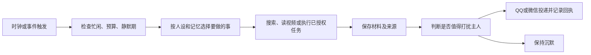

# 哈尔莫妮娅主动智能体：DSH + SnowLuma 技术路径报告

调研日期：2026-10-31。范围：主动关怀、主动找任务、资讯分享、B 站视频理解，以及与现有双通道系统的衔接。

**结论：优先评估 DSH 作为常驻运行时，组合 dsh-heartbeat 与一个只读 B 站工具；再按需要加入任务调度或事件监听。不要先重写一套“生活系统”，也不要把多个带自主循环、独立人设和公开发言能力的插件一次性全装上。**

本次只实际配置了 Windows 静默自启。以下插件仅进行了公开文档与源码调查，源码下载在项目根 `.cache/research-dsh`，没有安装插件、启动 DSH、登录 B 站或发出主动问候。当前线上仍是原来的 Codex + SnowLuma + iLink。

## 1. 别人的 bot 为什么能“自己找事做”

这些行为通常由六个环节拼起来：

这是本报告对源码链路的归纳，而不是模型在没有输入时持续“自己思考”。例如 `dsh-bili-whale` 的常驻调度器按计划向固定 DSH 会话排入一个新轮次；`dsh-heartbeat` 也会构造带插件来源的消息，让 agent 进行新一轮判断。[S1][S2]

SnowLuma 负责 QQ 进程接入与 OneBot 收发。决定“什么时候醒、去哪里看、要不要说”的主要是 DSH、插件及预设；把 SnowLuma 单独升级并不会得到这些能力。原版 qq-bridge 已有观望/活跃、唤醒、等待消息与主动收发工具，是通道整合的重要参考。[S3]

现网 Harmonia 的群聊概率接话仍由**收到消息**触发；每次 `codex exec` 接收隔离后的上下文，且工具为空。它目前没有主动生活循环。新配置的 2 分钟 Windows 任务仅检查进程，也不调用模型。

## 2. 最贴近需求的现成项目

版本取自本次拉取的源码 package.json，不把仓库版本、npm 已发布版本和兼容的 DSH 版本混为一谈。完整提交号见同目录「主动智能体调研来源.json」。

| 项目 | 本次源码版本 | 实际适合做什么 | 对本项目的判断 |
|---|---:|---|---|
| Kanadego/dsh-heartbeat | 2.0.1 | 主动陪伴、兴趣检索、素材整理、会话投递、静默和冷却控制 | **首选主动关怀候选**；需接通 QQ/微信投递和私有记忆边界 |
| Sacredbluedragon/dsh-bili-watch | 0.3.9 | 视频元数据、字幕、ASR、帧图、OCR、评论与弹幕；也可 CLI 调用 | **首选视频理解候选**；先用文字和预览帧，重处理按需启用 |
| Alterssss/dsh-bili-whale | 0.4.6 | 自定作息刷 B 站、日记、B 站互动和分享 | 最贴近“养鱼”的完整参考，但不建议原样接入现网 |
| c1overzz/dsh-bili-scroll | 2.3.1 | 按关键词筛视频、读内容、写日报、可自动评论 @ 主人 | 更偏 B 站日报；关闭外发并验证宿主兼容后才适合作候选 |
| whiteguo233/dsh-openbiliclaw | 0.6.3 | 连接 OpenBiliClaw 后端，提供推荐、反馈、画像和内容库工具 | 多平台资讯需求变大后再考虑；不是只装一个插件就能运行 |
| MichengAI/dsh-automation | 1.0.13 | 在独立会话中执行定时任务，查看每次运行结果 | 明确的日程/定时工作首选候选 |
| fuhefei/dsh-sentinel | 0.13.2 | 文件、HTTP、进程等条件变化时唤醒会话 | 条件驱动任务的候选，不用于每隔几分钟闲聊 |
| azazo1/dsh-browser | README 核对 | 通过扩展与 Native Messaging 操作独立 Chrome profile，返回编号文本 | 网页交互补充；不是视频理解引擎 |

依据：[S1][S2][S4][S5][S6][S7][S8][S9]。前三类插件之间有功能重叠，计划里不会默认全部启用。

### 2.1 主动关怀：dsh-heartbeat

其核心是定时准备素材，再让绑定的聊天会话选择是否开口。代码层限制静默期、忙时、每日表达量和冷却；兴趣检索、对话材料与未完成的话题可进入后续轮次。它比固定“早安/吃饭了吗”脚本更接近你的目标。[S1]

两个整合点不能省略：

- 它主要投递到 **DSH 会话**，会话里产生文字不等于 QQ/微信已经发出，必须接到现有发送器并核对回执。
- 它有全屏截图/视觉感知、会话观察及画像机制。第一阶段建议仅启用明确授权的主人私聊与兴趣信息；截图、窗口观察和心理画像先不启用。须先在隔离 profile 核实关闭方式，不能仅凭“本地加密”就视为没有数据外发。

源码中的兴趣检索发生在部分发送闸门之前，因此“本轮没说话”不等于“没有模型或搜索费用”。预算要同时限制探索和发送，不只数发了几条。[S1]

### 2.2 主动刷 B 站：whale/scroll 已经把循环做出来了

`bili-whale` 的调度器每 60 秒检查计划，到时通过 `sessionController.prompt` 的队列模式唤醒专用会话。提示会要求筛选、深读、写日记及按配额分享；它确实有“没人发消息也能醒来”的宿主逻辑。[S2]

但它的分享可走 **B 站评论 @ 或 B 站私信**，不能误认为已经接好 QQ/微信。对本项目，目标应是“只读 B 站内容 → 在已授权的主人私聊分享”，不是顺带把 bot 变成 B 站自动评论账号。[S2]

本次还发现两个需要适配的具体问题：

1. 同一提交的 `lib/index.js` 默认值为评论监听开、私信监听关；`tools/lib/config.mjs` 则是评论监听关、私信监听开。这是两处默认值不一致，不代表已证明某个真实账号会怎样运行；正式装载前必须检查最终有效配置。
2. README 说人设只取前 3000 字，但当前 scheduler 实际使用 `slice(0, 20000)`。它还默认读自己的 `~/.bili-ai/persona.md`，与本项目唯一的 `config/PERSONA.md` 不一致。需要接到同一人设源，而不是维护两个手工副本。[S2]

`bili-scroll` 更偏“筛选并出日报”。它的文档仍有“npm 停在 0.1.7”的提醒，但本次只读查询 npm 得到 **2.3.0**，仓库则为 **2.3.1**。这说明连安装说明都存在滞后，不能直接照旧教程装。其 README 也保留了部分桌面 profile 自动运行卡住的反馈，须在选定 DSH 版本验证。[S5]

### 2.3 “看视频”到底看了什么

建议把输出证据明确分为四档：

| 层次 | 实际输入 | bot 可以怎样描述 |
|---|---|---|
| 发现 | 标题、简介、封面、UP 主和发布时间 | “找到一个可能有意思的视频” |
| 阅读 | 字幕、转写、章节内容 | “读了这段字幕，主要讲……” |
| 视觉检查 | 预览帧、抽样帧、画面 OCR | “从这些画面看……”并注明采样范围 |
| 联合理解 | 文字 + 帧图 + 时间定位，必要时音频证据 | 对具体片段作有来源的判断 |

`dsh-bili-watch` 已有字幕 → 本地 ASR → OCR → 读图的降级流程，以及搜索/热榜、缓存和结构化结果。部分功能不需要额外依赖；抽帧和本地转写则需要 ffmpeg/Python/模型。先启用低成本路径，无法获得内容时明确跳过，别把只有封面的结果写成“我看完了”。[S4]

另一个较小的 `moxingovo/dsh-bilibili` 提供搜索、元数据、字幕、播放地址和帧图五类工具，可作备选；其帧图路径需要 attachment 服务和声明支持图片的模型路由。某些字幕需要 B 站登录，而且不是每个视频都有字幕轨。[S10]

`dsh-browser` 适合打开网页、导航和读取 DOM 文本；单凭浏览器“点了播放”并不意味着 LLM 消费了视频画面。已有视频提取器能完成的事不必改成浏览器点击流程。[S9]

### 2.4 新鲜事推荐：OpenBiliClaw 放在第二阶段更合适

它是独立的内容发现后端，DSH 插件只是消费者与工具入口。当前插件源码通过本机 `/api/agent-bridge` HTTP 接口调用后端；旧介绍中的逐次 Python CLI 调用已经不适用于本次核对的版本。插件暴露 22 个推荐、画像、反馈和本地收藏等工具，不等于每个工具都能直接给出完整视频理解结果。[S6]

如果以后要把 B 站、资讯站和其他内容源统一成兴趣推荐库，这一套值得复用；第一阶段只是“偶尔找一条新鲜事给主人”，引入完整后端、画像体系与浏览器连接会增加维护量。建议先用 heartbeat 的兴趣搜索和一个视频工具，确认需求后再升级。[S1][S6]

### 2.5 主动工作：区分定时、条件与自主选择

`dsh-automation` 适合“每天整理一次”“每周生成报告”这类有明确时间的任务，每次独立会话便于追踪结果。`dsh-sentinel` 适合“文件变化/HTTP 状态满足/进程结束后继续”，持久监视并唤醒对应会话，避免让模型不停轮询。[S7][S8]

真正的“自己找事做”，建议限定为从主人授权的待办清单里选择下一件事、或者寻找相关资料；不要把人格中的“主动一点”当成修改任意文件、发公开评论或操作其他账号的通行证。这是本项目的拟定边界，不是声称插件默认就替我们做好了。

## 3. 与现有 Codex 大脑怎样相处

DSH 是运行时，DeepSeek 是可选模型来源之一。官方 `dsh-llm-pi-ai` 支持多提供商和自定义兼容网关；所以使用 DSH 不必然意味着换成 DeepSeek 模型。但保留同一个 API 模型，也不等于仍由原来的 Codex CLI 驱动。[S11]

| 路线 | 可以复用什么 | 代价与结论 |
|---|---|---|
| A：DSH 做运行时，接当前自定义 API 模型 | DSH 原生心跳、视频工具、任务插件；现有通道与人设/记忆契约 | **若你接受更换运行时，这是少造轮子的主路线。** 需验证当前 Responses 提供商、工具调用、图片和推理参数在 DSH 中的兼容性 |
| B：Codex CLI 仍是唯一聊天推理入口 | 现有路由全部保留；视频 CLI/HTTP 服务可直接复用 | DSH 原生插件不能直接装入 Codex；需要额外调度、素材投递及状态适配，主动陪伴部分自写量更大 |
| C：DSH 对话运行时 + 官方 Codex 子智能体 | 主人授权的代码工作可委派给原生 Codex | 官方实现是新建、隔离、一次性的外部任务，不是无缝恢复当前 Harmonia 对话，也不是把所有 DSH 工具塞给 Codex。[S12] |

建议先在隔离的 DSH profile 验证 A，而线上继续用当前 Codex。若“Codex CLI 必须是唯一大脑”仍是硬约束，则选择 B，并接受需要一层较薄的适配代码。本次没有替你切换运行时。

当前查询 npm 的 DSH 为 `0.2.1-rc.5`，源码主分支 package.json 已为 `0.2.2-alpha.2`；相关桥接和插件常以 `0.2.1-rc.2` 声明兼容。不能把“都属于 0.2”当成已完成组合测试，应锁定一次实际通过测试的版本集合。[S3][S6][S8][来源快照]

## 4. 最小实现计划（仅计划，尚未执行）

### 阶段 0：确认运行时和兼容组合

在隔离 DSH profile 中只装候选运行时和必要插件，接当前 API 提供商做最小工具调用/图片测试。先关闭所有主动发送和截图观察。核对最终加载的工具清单，而不是看到“插件已安装”就算通过。

验收：模型可响应，插件真正加载，运行路径能在 Windows 上使用，失败不会影响现网；确认采用路线 A 或 B。

### 阶段 1：有分寸的主动关怀

优先复用 `dsh-heartbeat` 的节律、素材和冷却。只绑定主人私聊；使用现有 `owner_memory.json` 的只读投影，并动态注入唯一 `PERSONA.md`。建议初始值：60 分钟检查一次、23:00–09:00 不发送、每天主动私聊合计最多 2 条、刚收到主人消息后至少间隔 2 小时。这些是建议配置，不是当前已启用规则。

先运行“只生成候选、不发送”的观察模式，再开放主人私聊。要求每条关怀有具体缘由，例如待办后续、主人提过的事情或确实找到的新内容；没有依据时允许沉默，不随机编造“你是不是还没吃饭”。

验收：静默期无发送、模型沉默有效、两平台不重复打扰、重启不重复发送、群聊看不到私有候选。

### 阶段 2：只读 B 站与资讯分享

仅接一个视频工具，首选 `dsh-bili-watch`。从你明确选择的兴趣/UP 主范围取少量候选，先字幕和预览帧，必要时才开 ASR/OCR。保存 BV 号、来源、发布时间、读取范围和分享原因；已分享内容去重。把有价值的结果加入 heartbeat 的素材，不另起一套独立发言循环。

不开 B 站评论、私信、投币、关注或自动收藏同步。分享只通过现有 QQ/微信给主人。更大规模个性化推荐再评估 OpenBiliClaw。

验收：分享有可核对内容依据；无字幕/风控/下载失败明确记录；不把失败算成看完；浏览器账号和微信私聊内容不混入公开材料。

### 阶段 3：明确授权的主动工作

定时任务选 `dsh-automation`，条件触发选 `dsh-sentinel`。只对一两项明确的待办启用；需要代码工作时可评估官方 Codex 子智能体。已有任务调度器负责计时和运行历史，不再写另一套 cron 或无限自循环。

验收：相同任务不重叠运行；有超时/预算/取消；只在完成、失败或需要主人决定时通知。工作区写入与公开发送权限按任务单独配置。

### 无法直接省掉的少量适配

1. **双通道投递**：DSH 会话输出转成现有发送器接受的结果，目标由服务端身份/白名单决定，不让模型任意挑接收者。QQ 与微信共享同一份主动发送配额和去重键。
2. **单点人设与分层记忆**：插件独立的 persona/profile 不作为另一份权威人物配置。主人私有资料只进主人专用实例/作用域，不能因插件在宿主全局加载而对群聊可见。
3. **微信凭证与上下文**：复用已有联系人 context token，但不能把曾经登录成功视为永远可主动推送；过期时暂停该通道并记录待处理状态，不自行把私人消息改投 QQ 群。现有 iLink 桥接明确按服务器错误判断有效性，未承诺永久发送窗口。[S13]
4. **真正的回执**：只有通道确认后才记入发送额度；插件内部“已经生成/已投递到 DSH 会话”的状态不能替代外部投递成功。

## 5. 选择建议与当前边界

第一套试验组合建议是 **DSH + dsh-heartbeat + dsh-bili-watch + 现有 SnowLuma/iLink 通道**。先不要同时加 whale、scroll、OpenBiliClaw、浏览器和多个调度器。whale/scroll 留作成熟流程参考；需要它们的完整产品体验时，再评估替换，而不是叠加两套人格、素材库和主动发送逻辑。

如果只想先让“她偶尔有东西想跟你说”，先完成阶段 1 即可。主动陪伴的关键是上下文、材料质量、选择和节制，不是让模型全天高频消耗 token。成本预算应覆盖每次检索、模型推理、视频处理和重试，并按实际账本再调整。

本次调查读了 README、安装清单以及重点调度/发送/工具源码，没有把这些第三方插件逐个安装运行，也没有完成全面安全审计。作者写的“真看懂”“实机验证”属于其项目声明，不能替代本机验收；本报告明确指出了已发现的文档与源码差异。

## 来源与复核入口

以下均为项目维护者的仓库/文档；目录站只用于发现候选，没有作为最终功能依据。代码快照完整 SHA、提交日期和 npm 查询结果见 [主动智能体调研来源.json](主动智能体调研来源.json)。

- [S1：Kanadego/dsh-heartbeat，README 与调度代码](https://github.com/Kanadego/dsh-heartbeat/tree/329d73ff60268a94406693e32eac88fb1bbcba23)。重点：src/core/orchestrator.ts、src/core/preset-definition.ts、src/core/bindings.ts。
- [S2：Alterssss/dsh-bili-whale](https://github.com/Alterssss/dsh-bili-whale/tree/8b0009f8ce2ebdc421afcb2e727b19ac18912ec6)。重点：lib/scheduler.js、lib/index.js、tools/lib/config.mjs、tools/commands/comment.mjs。
- [S3：Derpyu520/qq-bridge](https://github.com/Derpyu520/qq-bridge/tree/6455d606c09d5c783f788b27ef93b5d58df9fb99)。重点：README、src/bridge.js、dsh/agent-presets、MCP 安全子集。
- [S4：Sacredbluedragon/dsh-bili-watch](https://github.com/Sacredbluedragon/dsh-bili-watch/tree/c7d1f97784d1c03702979e23509b7712baf86b86)。重点：README 中命令、降级链和依赖边界。
- [S5：c1overzz/dsh-bili-scroll](https://github.com/c1overzz/dsh-bili-scroll/tree/2c7b3f14f525360f8657b102ec453fd8f02baf3a)。重点：README、package.json、lib。
- [S6：dsh-openbiliclaw](https://github.com/whiteguo233/dsh-openbiliclaw/tree/894020bd8806f63dce87cf9548fce51dbe4923bf) 与 [OpenBiliClaw 后端](https://github.com/whiteguo233/OpenBiliClaw/tree/f4af7744995fe053df6cb771738a88d58c419b4a)。重点：src/bridge.ts、src/tools.ts、后端 docs/modules/bilibili.md。
- [S7：MichengAI/dsh-automation](https://github.com/MichengAI/dsh-automation/tree/70870e1f426f72f6efcfb0881c65dce320f39da7)。重点：README、package.json。
- [S8：fuhefei/dsh-sentinel](https://github.com/fuhefei/dsh-sentinel/tree/36bd74c12da6b85fc23b1d5f6dcde908208393f3)。重点：README.zh.md、兼容性声明。
- [S9：azazo1/dsh-browser](https://github.com/azazo1/dsh-browser)。本项只核对公开 README，未下载/安装浏览器扩展。
- [S10：moxingovo/dsh-bilibili](https://github.com/moxingovo/dsh-bilibili/tree/42cd1c9e7d975fc46cf62bd86024a134c37501d7)。重点：README.zh.md、package.json。
- [S11：DSH 官方多提供商适配器](https://github.com/deepseek-ai/deepseek-harness/blob/ce7073d51254c26cd63b22a60835b8f948deb447/packages/llm/llm-pi-ai/README.zh.md)。
- [S12：DSH 官方 Codex 子智能体](https://github.com/deepseek-ai/deepseek-harness/blob/ce7073d51254c26cd63b22a60835b8f948deb447/packages/subagent/subagent-codex/README.zh.md)。
- [S13：gtaifu/dsh-wechat-bridge](https://github.com/gtaifu/dsh-wechat-bridge)，结合当前 vendor/README.md、lib/ilink.mjs 和 Harmonia 微信适配器核对。
